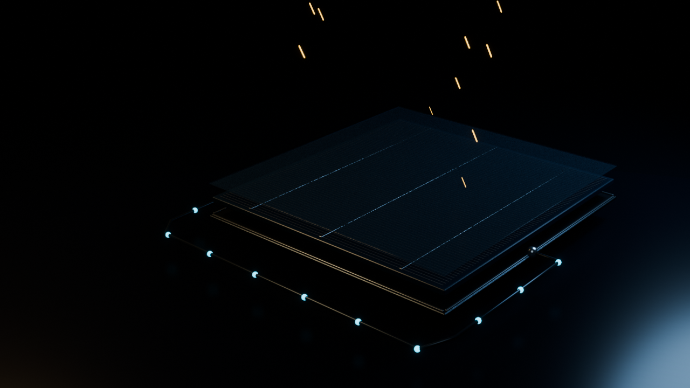
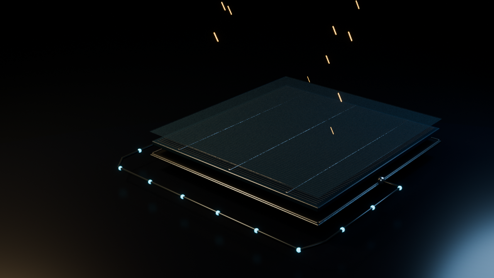
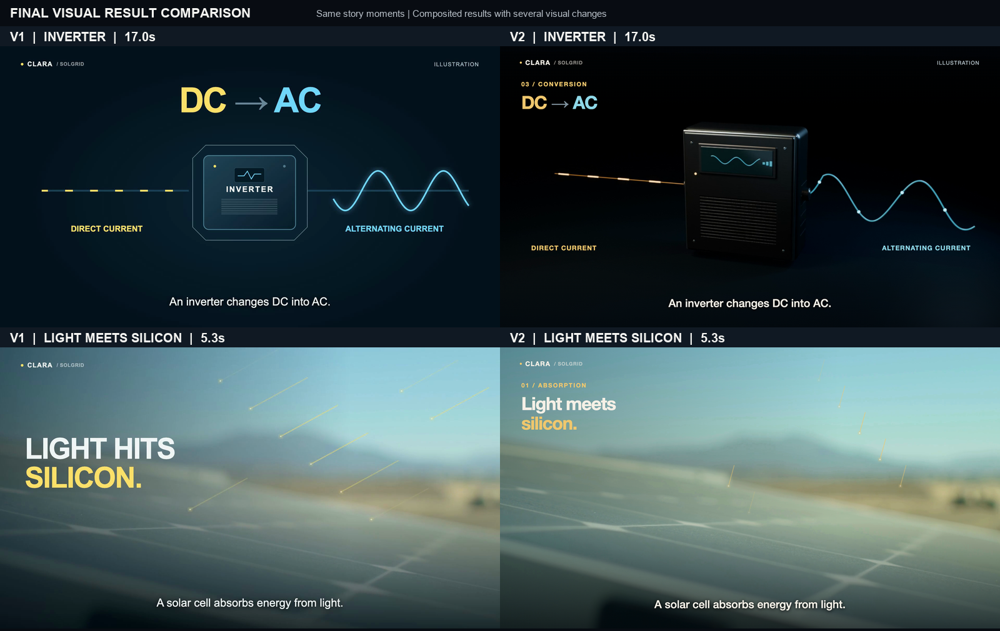

# Solar explainer: a real aesthetics revision

[Watch/download the 30-second final demo](demo.mp4)

The starting film combined real solar footage with flat explanatory diagrams. The revision preserved the scientific explanation and replaced the mechanism illustrations with locally authored 3D silicon and inverter scenes. A gold-light contact event opens the film; dark materials, warm key light and cool charge/AC accents carry through adjacent shots.

## Fixed-content lighting test

Same cell geometry, materials, camera, frame 75 and renderer settings. Only warm-key intensity changed: A 450 W, B 1650 W. B made the busbars and metal/glass layer edges more readable. Later framing and title clearance changes were separate adjustments, not effects attributed to that lighting variable.

[Art constraints](art-direction.json) · [Comparison record](controlled-comparison.json)

## Before and after

This image compares two full composited revisions; geometry, layout and grading all changed. It shows the resulting design, not a single-variable causal test or a measured improvement percentage.

## Soundtrack and checks

The final soundtrack is user-approved soft piano, rendered from authored MIDI notes through an installed piano instrument. No voice, choir or humming track was loaded. Two earlier local music-model attempts were rejected by the user for unwanted voices; negative prompt tags were not treated as proof of absence.

Final delivery: 30 seconds, 1920×1080, 30 fps, H.264 with AAC audio. Full-file decode and audio-level checks passed. Sampled final opening/credits and an earlier 17-frame visual review were inspected. The decoded final music closely matched the approved piano master after correcting an export delay. The assistant did not audition audio; the user approved the soundtrack. Full real-time video playback was not claimed. The repository demo is a compressed 720p distribution copy.

## Credits and rights

- Real footage: [solar farm](https://www.pexels.com/video/drone-shot-of-a-vast-solar-farm-12858696/) by Braeson Holland; [panel close-up](https://www.pexels.com/video/extreme-close-up-of-a-solar-panel-9788594/) and [rooftop panels](https://www.pexels.com/video/solar-panels-on-the-roof-9790192/) by Kindel Media. [Pexels License](https://www.pexels.com/license/).
- Science: U.S. Department of Energy, [How Does Solar Work?](https://www.energy.gov/cmei/systems/how-does-solar-work) and [Solar Photovoltaic Technology Basics](https://www.energy.gov/cmei/systems/solar-photovoltaic-technology-basics).
- Final assembly: actual OpenMontage VideoCompose / Remotion atelier path. Upstream source snapshot was selected from `main`, not documented as a pinned full clone. OpenMontage is a separate project.
- Illustrations and arrangement: original local work for Clara / Solgrid. Layered cells, colored markers and the AC sine wave are conceptual illustrations, labeled onscreen.
- Piano instrument: installed GarageBand Classical Grand; [GarageBand terms](https://www.apple.com/legal/sla/docs/GarageBand.pdf). Instrument samples are not included or offered as a sample library.

The example is an edited creative work with source credit. Stock footage, software and instrument licenses are not replaced by the repository's MIT license. It does not claim a branded hardware model, measured power output, one-click generation, viral growth or availability of these tools in the Solgrid marketplace.
